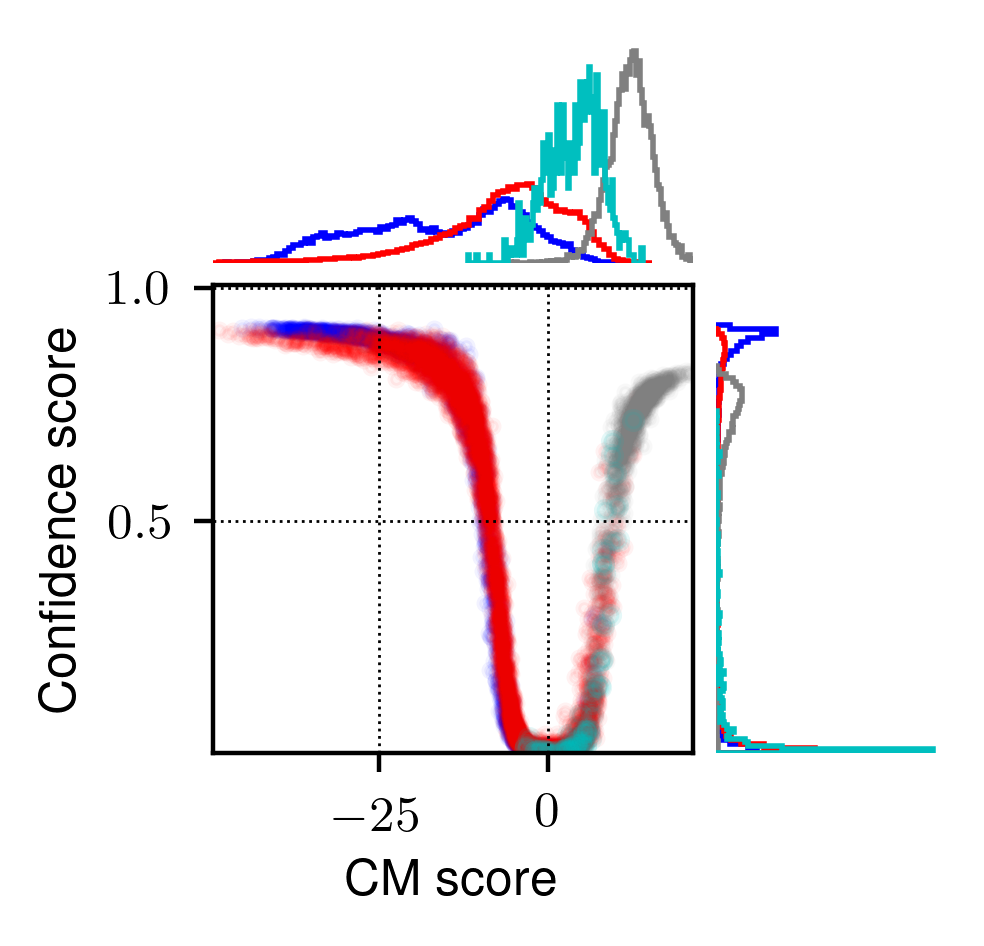

# SSL-based front-end for spoofing countermeasure




This project estimates the confidence of speech spoofing countermeasures. 

Arxiv link: [https://arxiv.org/abs/2110.04775](https://arxiv.org/abs/2110.04775)

```bibtex
Xin Wang, and Junichi Yamagishi. Estimating the Confidence of Speech Spoofing Countermeasure. In Proc. ICASSP, 6372–6376. 2022.

@inproceedings{Wang2021,
archivePrefix = {arXiv},
arxivId = {2110.04775},
author = {Wang, Xin and Yamagishi, Junichi},
booktitle = {Proc. ICASSP},
eprint = {2110.04775},
pages = {6372--6376},
title = {{Estimating the confidence of speech spoofing countermeasure}},
year = {2022}
}

```
 
This project requires non-standard data sets. Apologize that the code is dirty. 


## How to use -- part 1

Part 1 is for Max-prob., Energy, and Conf.Branch systems. 

```sh
PATH_TO_PROJECT   -> System in paper
AM-softmax-maxprob/config_train_asvspoof2019 -> T1 AM softmax Max prob.
AM-softmax-energy/config_train_asvspoof2019 -> T1 AM softmax Energy
AM-softmax-conf/config_train_asvspoof2019 -> T1 AM softmax Conf. branch
Softmax-maxprob/config_train_asvspoof2019 -> T1 Plain softmax Max prob.
Softmax-energy/config_train_asvspoof2019 -> T1 Plain softmax Energy      
Softmax-conf/config_train_asvspoof2019 -> T1 Plain softmax Conf. branch      
Softmax-energy/config_train_asvspoof2019_esp -> T2 Plain softmax energy
Softmax-energy/config_train_asvspoof2019_bc10 -> T3 Plain softmax energy
```

For m-distance and supervised-based OOD systems, see part 2

### Step.1 prepare ASVspoof data

1. Download [ASVspoof 2019 LA](https://doi.org/10.7488/ds/2555) and convert FLAC to WAV
    * By the time this project was written, the code does not load FLAC (to simplify dependency)
    * Now .flac can be loaded if `soundfile` with FLAC support is installed
3. Put eval set waves to ./DATA/asvspoof2019_LA/eval
4. Put train and dev sets to ./DATA/asvspoof2019_LA/train_dev
5. Make sure that the two folders contain the waveform files: 
```sh
   $: ls DATA/asvspoof2019_LA/eval 
   LA_E_1000147.wav
   LA_E_1000273.wav
   LA_E_1000791.wav
   LA_E_1000841.wav
   LA_E_1000989.wav
   ...
   $: ls DATA/asvspoof2019_LA/eval | wc -l
   71237

   $: ls DATA/asvspoof2019_LA/train_dev
   LA_D_1000265.wav
   LA_D_1000752.wav
   LA_D_1001095.wav
   LA_D_1002130.wav
   LA_D_1002200.wav
   LA_D_1002318.wav
   ...

   $: ls DATA/asvspoof2019_LA/train_dev | wc -l
   50224
```

For NII internal user, the two folders can be symbolic links to
* eval -> `/Database/ASVspoof2019/logical_access_condition/ASVspoof2019_LA_eval/wav`
* train_dev -> `/Database/ASVspoof2019/logical_access_condition/train_dev`


### Step.2 run demonstration script   
```sh
bash 00_demo.sh PATH_TO_PROJECT
```
where `PATH_TO_PROJECT` can be one of the name listed at beginning of this section, for example
```sh
bash 00_demo.sh Softmax-energy/config_train_asvspoof2019
```


This demo.sh will 
1. install conda environment if it is not ready
2. download pre-trained models and additional datasets (espnet, vcc, bc10)
3. scoring the test sets using pre-trained models
4. train a new model
6. scoring the test sets using the newly trained model
  
Note that `Softmax-energy/config_train_asvspoof2019_bc10` needs BC data that has to be downloaded separately (due to LICENSE). See Note 1 below.

### Step.3 get results
Get evaluation metrics using [02_metrics.ipynb](02_metrics.ipynb). 

The inputs to the notebook are score files (e.g., `log_output_pretrained_config_test_***_score.txt`). The metrics are computed given the detection scores (and optionally OOD detectio scores)


## How to use -- part 2

For m-distance and supervised-based OOD systems

```sh
PATH_TO_PROJECT   -> System in paper
Softmax-m-distance/config_train_asvspoof2019_ood -> OOD part for T1 M-distance
Softmax-m-distance/config_train_asvspoof2019_esp_oe -> T2 M-distance
Softmax-m-distance/config_train_asvspoof2019_bc10_oe -> T3 M-distance
Softmax-ood-supervised/config_train_asvspoof2019_esp -> OOD part for T2 Supervised
Softmax-ood-supervised/config_train_asvspoof2019_bc10 -> OOD part for T3 Supervised
```

The term `OOD part` means that the script will only produce the OOD detection score. It must be used together with the spoofing-detection score produced by `Softmax-energy/config_train_asvspoof2019`. 

```bash
   | baseline | --> spoofing score      |
                                        | -> results
   | OOD      | --> OOD-detection score |
```


For `_oe` systems, the outlier-exposure--fine-tuned model will produce spoofing-detection score.
```bash
   | OE-fine-tuned model | --> spoofing score |
                                              | -> results
   | OOD      | --> OOD-detectio score        |
```

### Step. 1 run baseline part 1 

If not, run `00_demo.sh Softmax-energy/config_train_asvspoof2019`

We need the data package and pre-trained models. 

### Step. 2 run scripts


**For Supervised OOD detector (T2 Supervised, T3 Supervised)**

```bash
03_sample_ood_supervised.sh <MODEL_NAME>
```
 
where MODEL_NAME can be
```bash
Softmax-ood-supervised/config_train_asvspoof2019_esp
Softmax-ood-supervised/config_train_asvspoof2019_bc10
```

`esp` corresponds to T2 and `bc10` corresponds to T3.

The output scores from the OOD detectors are named as `log_output_trained_***_score.txt`. 

A notebook is to be prepared to show the usage of this OOD score

**For M-distance (T1)**

```bash
03_sample_m_distance.sh Softmax-m-distance/config_train_asvspoof2019_ood
```

This will create a wrapper model with class-based mean/std of embedding vectors. 

The output scores from the m-distance-based OOD detectors are named as `log_output_trained_***_score.txt`. 

**For M-distance (T2 T3)**

```bash
03_sample_m_distance.sh Softmax-m-distance/config_train_asvspoof2019_bc10_oe

03_sample_m_distance.sh Softmax-m-distance/config_train_asvspoof2019_esp_oe
```

This will train the spoofing detector with outlier-exposure; then create a wrapper model with class-based mean/std of embedding vectors. 

The output scores include
* from the OE-based spoofing detector, named as `log_output_trained_***_oe_score.txt`. These scores are scores of spoofing
* from the m-distance-based OOD detector, named as `log_output_trained_***_score.txt`. These scores are OOD indicator
 


## Folder structure
Files marked with = are generated after running 00_demo.sh.

```sh
|- DATA: data folder 
|  |= asvspoof2019_LA
|  |  |= protocol.txt: 
|  |  |   protocol file
|  |  |   this will be loaded by pytorch code for training and evaluation
|  |  |= scp: 
|  |  |   list of files for traing, dev, and eval sets
|  |  |= train_dev: 
|  |  |   waveform for train and dev sets   
|  |  |= eval: 
|  |  |   waveform for eval sets   
|  |
|  |= bc_release (folder for Blizzard Challenge, same structure as asvspoof2019_LA)
|  |= espnet_release (folder for ESPnet data, same structure as asvspoof2019_LA)
|  |= vcc_release  (folder for VCC data, same structure as asvspoof2019_LA)
|
|- 00_demo.sh: demo inference and training script for energy, max-prob, and conf.branch systems
|- 03_sample_ood_supervised.sh: training & inf. script for Supervised OOD detector (Supervised)
|- 03_sample_m_distance.sh: training & inf. script for M-distance OOD detector (M-distance T1)
|- 03_sample_m_distance_oe.sh: training & inf. script for M-distance OOD detector (M-distance T2/T3)
|   the above meta scripts will call sub-scripts below
|
|- 01_conda.sh: script to install conda environment
|- 01_eval.sh: script that will be used for scoring the test set
|- 01_train.sh: script that will be used for training a model
|- 01_train_md.sh: script for training using m-distance OOD detector 
|- 01_train_md_oe.sh: script for outlier-exposure (OE) training + m-distance OOD detector
|- 01_train_ood.sh: script for training Supervised OOD detector
|- 01_eval_ood.sh: script for inference using Supervised OOD detector
|- 01_eval_md_oe.sh: script for inference using OE + m-distance OOD
|- 01_eval_md.sh: script for inference using m-distance OOD
|
|- config_train_asvspoof2019.py: configuration to use training set of ASVspoof2019 LA (T1)
|- config_train_asvspoof2019_esp.py: configuration to use training set of ASVspoof2019+ESPNet (T2)
|- config_train_asvspoof2019_bc10.py: configuration to use training set of ASVspoof2019+BC (T3)
|- config_train_asvspoof2019_ood.py: configuration for m-distance-based OOD (using T1)
|- config_train_asvspoof2019_esp_oe.py: configuration to run outlier exposure (OE) fine-tuning on T2
|- config_train_asvspoof2019_esp_oe_ood.py: configuration for m-distance-based OOD after OE on T2
|- config_train_asvspoof2019_bc_oe.py: configuration to run outlier exposure (OE) fine-tuning on T3
|- config_train_asvspoof2019_bc_oe_ood.py: configuration for m-distance-based OOD after OE on T3
|- config_train_asvspoof2019_bc10.py: configuration to use training set of ASVspoof2019+BC (T3)
|- config_test_asvspoof2019.py: configuration for test set ASVspoof2019 LA (E1)
|- config_test_vcc.py: configuration for test set VCC (VCC part of E2)
|
|- main.py: main.py that will be used by each model for training/scoring
|
|- Softmax-energy: project for model using softmax and energy estimator
|  |- config_train_asvspoof2019 (systems trained using config_train_asvspoof2019.py)
|  |  |- 01 (running using the first random seed)
|  |  |  |- model.py: model definition, Pytorch code
|  |  |  |= 01_train.sh: script copied from the root
|  |  |  |= 01_eval.sh:  script copied from the root
|  |  |  |= main.py:     main.py copied from the root
|  |  |  |= config_*.py: configuration files copied from the root
|  |  |  |= __pretrained
|  |  |  | |= trained_network.pt: pre-trained model by Xin
|  |  |  |
|  |  |  |= trained_network.pt: trained model after the full training process
|  |  |  |= *.dic: 
|  |  |  |   cache files to save the duration information of each trial
|  |  |  |   they are automatically generated by the code
|  |  |  |   they can be deleted freely
|  |  |  |= log_train.txt: training log
|  |  |  |= log_train_err.txt: error log (it also contains the training loss of each trial)
|  |  |  |= log_gen_err.txt: error log during scoring
|  |  |  |= log_output_*.txt: evaluation log
|  |  |  |= log_output_pretrained_*_score.txt: score of each trial, using pre-trained models
|  |  |  |= log_output_trained_*_score.txt: score of each trial, using newly trained models
|  | 
|  |- config_train_asvspoof2019_espnet (systems trained using config_train_asvspoof2019_esp.py)
|  |  | ...
|
|- Softmax-ood-supervised: project for supervised OOD detector
|  |- config_train_asvspoof2019_esp (systems trained using config_train_asvspoof2019_esp.py, T3)
|     |- 01
|         |- model.py: model definitionn. This model.py is different from other.
|                      the target label loaded will differentiate in- and out-of-distribution
|         |= log_output_trained_*_score.txt: score for OOD detection
|
|- Softmax-m-distance: projeect for M-distance-based OOD detector
|  |- config_train_asvspoof2019_ood (using config_train_asvspoof2019_ood.py, T1 M-distance)
|     |- 01
|         |- model.py: same as that in Softmax-energy
|         |- model_ood.py: a wrapper that learns clusters for M-distance calculation
|         |= trained_network.pt: from Softmax-energy/config_train_asvspoof2019, for initialization
|         |= trained_network_md.pt: trained model model with clusters for M-distance
|         |= log_output_trained_*_score.txt: score for OOD detection
|
|  |- config_train_asvspoof2019_esp_oe (using config_train_asvspoof2019_ood.py, T2 M-distance)
|     |- 01
|         |- model.py: same as that in Softmax-energy
|         |- model_oe.py: a wrapper that fine-tune the model by OE
|         |- model_ood.py: a wrapper that learns clusters for M-distance calculation
|         |= trained_network.pt: from Softmax-energy/config_train_asvspoof2019, for initialization
|         |= trained_network_md.pt: fine-tuned model model with OE
|         |= trained_network_oe_md.pt: fine-tuned model + clusters for M-distance
|         |= log_output_trained_*_score.txt: score for OOD detection
|         |= log_output_trained_*_oe_score.txt: score for spoofing detection (by OE-tuned model)
|- 
```

The log files: 
* training log `log_train_*.txt` is self-explanable.
* spoofing detection score file `log_eval_*_score.txt` has multiple columns (see Note 3): File name, label, score, confidence
```bash
  LA_E_1066571 1 19.160793 20.1
```
* OOD detection score file `log_train_*.txt` may have two or three columns: 
```bash
  Filename OOD_score
  LA_E_1066571 19.160793

  Filename cluster_id OOD_score
  LA_E_1066571 12 19.160793
```
 


## Notes
1. Blizzard data must be downloaded manually by each user, due to license. Thus, please do not try `Softmax-energy/config_train_asvspoof2019_bc10` first. Please try other models first, then please check README in `DATA/bc_release`
   * **Important node**: after running 00_demo.sh, the downloaded data package contains lists of training and validation sets in `DATA/bc_release/scp`. Note that these two lists `DATA/bc_release/scp/train.lst` and `DATA/bc_release/scp/val.lst` have a wrong format (sorry for that!). It contains four columns with meta informatio, but the lists should only contain the name of files. Hence, please do these manually:
     * Please `mv DATA/bc_release/scp/train.lst DATA/bc_release/scp/train_old.lst; awk '{print $2}' DATA/bc_release/scp/train_old.lst > DATA/bc_release/scp/train.lst`
     * Please `mv DATA/bc_release/scp/val.lst DATA/bc_release/scp/val_old.lst; awk '{print $2}' DATA/bc_release/scp/val_old.lst > DATA/bc_release/scp/val.lst`
     

2. If GPU memory is insufficient, please reduce `--batch-size` in `01_train.sh`

3. Output score is in text format:

   ```
   File name, label, score, confidence
   LA_E_1066571 1 19.160793 20.1
   ```

    If the label of a trial is given in the protocol file, the label will be: 

    ```
    0, which denotes spoof
    1, which denotes bona fide
    ```

    If the label of a trial is not given in the protocol file, the label will be:
    ```
    -1, which means unknown (not provided)
    ```
    
4. Accordingly, the code assumes 0 and 1 as the tables for spoof and bona fide
   trials, respectively.   
5. `main.py` and `config_***.py` in this project are slightly different from those in other projects (e.g., `02_asvspoof`, `03_asvspoof_mega`, `04_asvspoof_toy`). Please use them across projects.

6. ~Not all the models are here due to the messy scripts (e.g., that in M-distance)~
   
7. For a high-level explanation of how the functions and objects work in the script, please check `../../README.md`

## TODO

Add notebook to show evaluation using spoofing detection score + OOD detection score.

---
That's all